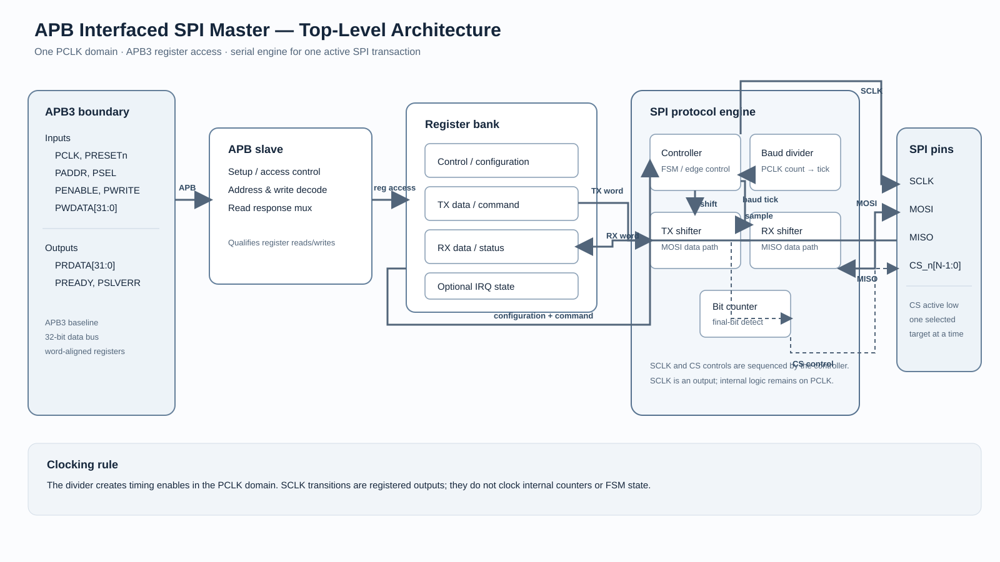

# APB Interfaced SPI Master IP Core

A standalone learning project for an APB3-programmable SPI master peripheral. The design is being developed from interface and architecture definitions toward RTL and simulation, one module at a time.

## Current status

Phase 1 top-level architecture is documented. RTL has not started.

## Architecture



- [Phase 1 reference sheet](docs/01_architecture/phase_1_top_level_architecture.md)
- [Editable draw.io diagram](docs/01_architecture/top_level_architecture.drawio)
- [SVG diagram export](docs/01_architecture/top_level_architecture.svg)

## Proposed baseline

- APB3 programming interface with 32-bit address/data defaults
- One synchronous `PCLK` domain with active-low `PRESETn`
- 8-bit SPI transfers supporting modes 0–3
- Parameterized active-low chip-select outputs
- Clock-divider timing enables generated from `PCLK`
- No FIFO or DMA in the initial architecture

The register map, exact divider range, and optional interrupt behavior will be defined before RTL implementation.

## Repository layout

```text
apb-spi-master-ip/
├── docs/
│   ├── 01_architecture/       # Top-level diagrams and interface reference sheets
│   ├── 02_fsm_flowcharts/     # Controller flowcharts (Phase 4)
│   └── 03_learning_notes/     # Protocol notes and calculations
├── rtl/                       # Synthesizable RTL, added module by module
├── tb/                        # Simulation testbench
├── scripts/                   # Build and automation scripts
└── README.md
```
