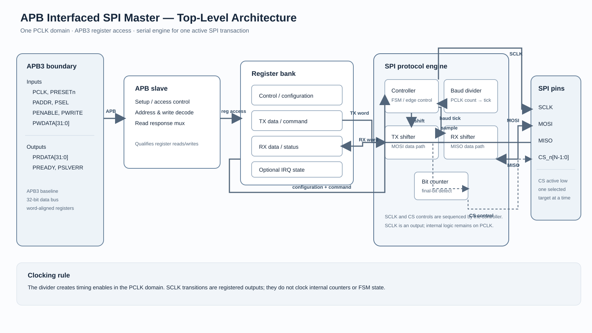
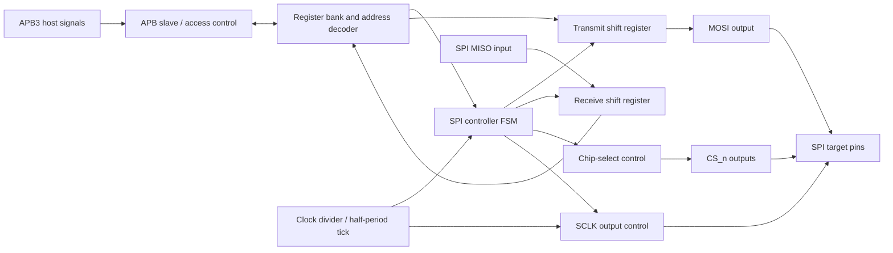

# Phase 1 — Top-Level Architecture

## Purpose

An APB host configures the peripheral and writes a transmit word. The SPI master engine serializes that word on MOSI, samples the selected target on MISO, and makes the received word and completion status visible to APB software.

This is an architecture reference, not RTL. Signal names are proposed interface names; widths in brackets are parameterized where noted.

## Baseline assumptions

| Item | Phase 1 baseline |
|---|---|
| APB | APB3, 32-bit address and data by default; one setup phase followed by one access phase |
| Clock/reset | All internal logic uses `PCLK`; active-low `PRESETn` |
| SPI word | 8 bits per transfer in the initial design |
| SPI modes | CPOL/CPHA configuration supports modes 0–3 |
| Targets | One active-low `CS_n` output per target; `NUM_CS` is a parameter |
| Throughput | One transfer at a time; no FIFO or DMA assumed in this phase |
| Baud rate | Divider derives SPI timing enables from `PCLK`; `SCLK` is an output, not an internal fabric clock |

## Top-level block diagram

### Block responsibilities

| Block | Responsibility |
|---|---|
| APB slave / access control | Recognize APB setup and access phases; qualify register reads and writes; return `PREADY`, `PRDATA`, and `PSLVERR`. |
| Address decoder and register bank | Select the addressed register; hold configuration, transmit data, receive data, status, and (if included later) interrupt state. |
| SPI controller FSM | Start and sequence a transfer; control chip-select assertion, shifting, sampling, and completion. Detailed states are Phase 4. |
| Clock divider | Count `PCLK` cycles using the programmed divider and create a timing enable for each SPI half-period. |
| TX shift register | Hold the software-provided word and present one bit at a time to MOSI in the configured bit order. |
| RX shift register | Sample MISO at the mode-defined edge and assemble the received word. |
| Bit counter | Track the number of bits sent/sampled and signal the final bit. |
| SCLK and chip-select controls | Drive mode-correct idle/active `SCLK` and select exactly one target for a transfer. |
| Optional interrupt/status logic | Latch completion/error events and drive the optional `IRQ` sideband. It can be omitted in a minimal first revision. |

## Boundary signal list

Directions below are relative to the SPI Master IP. Default bus widths are shown; parameters may change them.

### APB3 and clock/reset

| Signal | Direction | Width | Meaning |
|---|---:|---:|---|
| `PCLK` | Input | 1 | APB and internal system clock. |
| `PRESETn` | Input | 1 | Asynchronous active-low reset input (synchronous deassertion is recommended at integration). |
| `PADDR` | Input | `ADDR_WIDTH` (default 32) | APB byte address. A 32-bit register bank normally uses word-aligned offsets. |
| `PSEL` | Input | 1 | Selects this APB peripheral. |
| `PENABLE` | Input | 1 | High during the APB access phase. |
| `PWRITE` | Input | 1 | High for write, low for read. |
| `PWDATA` | Input | `DATA_WIDTH` (default 32) | APB write data. |
| `PRDATA` | Output | `DATA_WIDTH` (default 32) | APB read data. |
| `PREADY` | Output | 1 | Completes the APB access when high in the access phase. A simple register-mapped implementation can be always ready. |
| `PSLVERR` | Output | 1 | Marks an invalid or unsupported APB access; exact error policy is a Phase 2 decision. |

This baseline is APB3: it does not include APB4 byte strobes (`PSTRB`) or protection attributes (`PPROT`). Those can be added if the intended integration requires APB4.

### SPI pins

| Signal | Direction | Width | Meaning |
|---|---:|---:|---|
| `SCLK` | Output | 1 | Serial clock generated by the master. Its idle level is selected by CPOL. |
| `MOSI` | Output | 1 | Master-out, target-in serial data. |
| `MISO` | Input | 1 | Master-in, target-out serial data. |
| `CS_n` | Output | `NUM_CS` (default 1) | Active-low target selects. Inactive outputs remain high; normally only one bit is low. |

### Optional sideband

| Signal | Direction | Width | Meaning |
|---|---:|---:|---|
| `IRQ` | Output | 1 | Optional interrupt request for an enabled completion or error event. Status remains readable over APB. |

## Internal connection inventory

These are logical connections between blocks, not top-level pins. They define the planned module boundaries for later phases.

| Signal group | Source → destination | Purpose |
|---|---|---|
| `reg_addr`, `reg_wr_en`, `reg_rd_en`, `reg_wr_data`, `reg_rd_data` | APB access control ↔ register bank | Qualified APB register access. Read data returns to the APB response mux. |
| `cfg_cpol`, `cfg_cpha`, `cfg_lsb_first`, `cfg_divider`, `cfg_cs_sel`, `cfg_irq_en` | Register bank → SPI engine | Latched or live configuration consumed by the controller. Configuration must be stable for a transfer. |
| `cmd_start`, optionally `cmd_abort` | Register bank → controller | Start a transfer after software has prepared configuration and TX data. Abort is optional and needs a defined protocol policy. |
| `tx_data`, `tx_load`, `tx_shift` | Register bank/controller → TX shifter | Load the programmed word, then advance one bit on the scheduled shift edge. |
| `rx_sample`, `rx_data`, `rx_valid` | MISO/controller/RX shifter → register bank | Sample serial input, expose the assembled word, and indicate a completed receive word. |
| `spi_busy`, `spi_done`, `spi_error` | Controller → register bank/interrupt logic | Update readable status and optionally raise an interrupt. |
| `baud_tick` | Divider → controller/SCLK control | Timing enable marking an SPI half-period; no separate internal clock domain is created. |
| `bit_count`, `last_bit` | Bit counter → controller | Track progress and identify the final bit. |
| `sclk_set`, `sclk_toggle` | Controller/divider → SCLK control | Set the CPOL idle level and request mode-correct clock transitions. |
| `cs_assert`, `cs_release`, `cfg_cs_sel` | Controller/register bank → chip-select control | Assert the selected active-low target for the transaction and release it at completion. |
| `irq_status`, `irq_enable`, `irq_clear` | Status/register bank ↔ interrupt logic | Optional event latch, mask, and clear path. |

## Transaction path at a glance

1. Software writes configuration and the transmit-data register over APB.
2. Software issues a start command. The controller captures the transaction configuration and TX word.
3. The engine asserts the selected `CS_n`, sets `SCLK` to CPOL, and uses divider ticks to sequence edges.
4. The TX shifter advances MOSI and the RX shifter samples MISO according to CPHA and bit order.
5. After the configured word length (8 bits in this baseline), the engine releases chip select, marks `done`, and makes RX data readable. An optional IRQ can signal the event.

## Design boundaries to settle before RTL

- Whether `IRQ` is part of revision 1.
- Whether `NUM_CS`, word length, and divider range are parameters or fixed constants.
- Whether chip select stays asserted across multiple words (a future FIFO/burst feature) or always releases after each 8-bit word.
- The documented APB error behavior and whether reads of write-only/unmapped registers return zero or raise `PSLVERR`.
- Reset values and whether a transfer can be aborted.

## Next phases

1. **Phase 2 — APB slave interface:** exact register map, reset values, access permissions, read mux, write enables, and address decode.
2. **Phase 3 — SPI protocol engine:** shift/sample edge rules, divider counter, bit counter, and data paths.
3. **Phase 4 — FSMs:** detailed Idle, Setup, Transfer, and Completion flowcharts and sequential actions per state.
