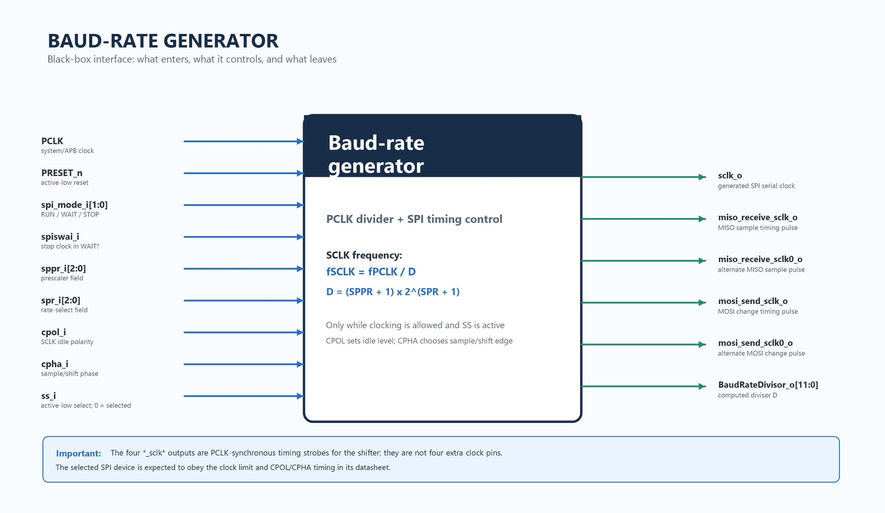
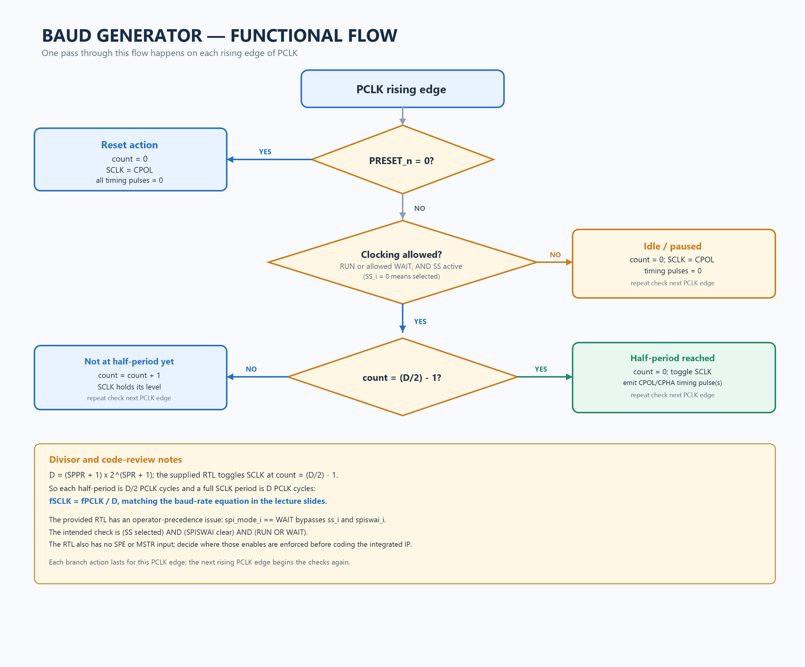

# Baud-Rate Generator: Beginner Guide

This guide explains the baud-rate generator in the APB-interfaced SPI Master project using a black-box diagram, a functional flowchart, and the questions discussed so far. It intentionally does **not** include the internal mux/register microarchitecture; we can design that separately later.

It supplements the repository's [Phase 1 top-level architecture](../01_architecture/phase_1_top_level_architecture.md).

## What I inspected

The public GitHub repository is currently an architecture scaffold. Its README says the RTL has not started, and `rtl/README.md` confirms that no synthesizable modules are in the repository yet. I also analyzed the `Baud_Rate_Generator.v` and `Baud_Rate_Generator_tb.v` files you shared earlier in the chat. Those files are local project material and are not present on GitHub `main` at the time of this review.

So this document distinguishes three things:

1. **Project baseline** — the GitHub repository currently plans an APB-programmed SPI master, with one internal `PCLK` clock domain.
2. **Lecture reference** — the register names, divisor equation, and intended power/selection behavior visible in your photos.
3. **Supplied local RTL** — the actual module and testbench you shared, including a control-condition issue called out below.

## 1. SPI and the baud-rate generator in plain language

**SPI** (Serial Peripheral Interface) is a synchronous connection between a controller and a peripheral such as a temperature sensor. In a typical four-wire connection:

- `SCLK` is the clock driven by the SPI master.
- `MOSI` carries bits from master to peripheral.
- `MISO` carries bits from peripheral to master.
- `SS`/`CS` selects the peripheral; this project uses active-low `ss_i`, so `ss_i = 0` means selected.

An SPI peripheral normally does not send a continuous stream at a speed it chooses. The master selects it and supplies `SCLK`; the peripheral shifts its response in time with those clock edges. For example, the master might send a “read temperature” command on MOSI, then clock the sensor's temperature bits back on MISO.

The baud-rate generator is the **tempo control** for this exchange. Imagine the master as a teacher tapping a desk so both people know when to send or read the next bit. `PCLK` is the fast internal system beat; the generator divides it to make the slower `SCLK` beat the selected peripheral supports.

### Why not use `PCLK` directly as SPI `SCLK`?

`PCLK` clocks the APB bus and internal logic. It may be much faster than the peripheral supports, and the peripheral is connected to the SPI pins rather than the APB clock net. The generator derives a programmable SPI clock from `PCLK`, so the master can choose a suitable speed while keeping the internal design synchronous to `PCLK`.

### How do we know the peripheral's speed?

Read that peripheral's datasheet. Check its maximum SPI clock frequency and timing limits, and configure the master at or below the supported rate. Also match the required SPI mode (`CPOL`/`CPHA`). The master controls the clock rate; the peripheral's datasheet tells us the safe limit.

## 2. Block boundary diagram



The blue arrows point **into** the block; the green arrows point **out**. `sclk_o` is the generated SPI clock. The four `*_sclk*` signals are internal timing strobes for the shifter, not four extra SPI clock pins.

## 3. Inputs: source and purpose

Names below match the supplied local module where possible. The source column describes the expected connection in the complete IP.

| Input | Width | Expected source | Why the generator needs it |
|---|---:|---|---|
| `PCLK` | 1 | System/APB clock input | Provides the fast reference ticks that are divided down. The supplied RTL updates its sequential logic on `posedge PCLK`. |
| `PRESET_n` | 1 | Active-low reset input (the slides also write `PRESETn`) | The supplied RTL uses an asynchronous active-low reset. When low, it resets the counter and puts SCLK at its configured idle polarity. |
| `sppr_i` | 3 | SPI baud-rate register, bits `SPPR[2:0]` | Prescaler selection used to calculate the divisor. |
| `spr_i` | 3 | SPI baud-rate register, bits `SPR[2:0]` | Rate selection used to calculate the divisor. |
| `cpol_i` | 1 | SPI Control Register 1, `CPOL` | Selects SCLK's idle level: 0 means low; 1 means high. |
| `cpha_i` | 1 | SPI Control Register 1, `CPHA` | Selects which SCLK edge is the sample edge and which is the data-change edge. |
| `ss_i` | 1 | Slave-select/control logic | Active-low selection input: 0 means the peripheral is selected. The generator should only run for a selected transfer. |
| `spiswai_i` | 1 | SPI Control Register 2, `SPISWAI` | In Wait mode, controls whether SPI clock generation is allowed to continue. The lecture description says generation stops when this bit is asserted. |
| `spi_mode_i` | 2 | CPU/system power-mode control | Tells the generator whether the system is in Run, Wait, or Stop mode. The supplied module defines Run=`00`, Wait=`01`, Stop=`10`. |

The lecture's baud-rate block port list does not show `SPE` (SPI enable) or `MSTR` (master-mode enable), although one lecture microarchitecture drawing appears to use an `mstr` qualifier. The supplied local RTL also has no `SPE` or `MSTR` input. Before integrating the block, decide whether those conditions are enforced upstream or need to be explicit inputs. The broad block diagram above reflects the supplied module's port list.

## 4. Outputs: what each one means

| Output | Width | Meaning |
|---|---:|---|
| `sclk_o` | 1 | Serial clock driven toward the selected SPI peripheral. It idles at `CPOL` when the generator is inactive. |
| `BaudRateDivisor_o` | 12 | Computed divisor `D`, made visible to the surrounding SPI logic. |
| `miso_receive_sclk_o` | 1 | PCLK-synchronous pulse that tells the receive shifter when to sample MISO for one edge/polarity case. |
| `miso_receive_sclk0_o` | 1 | The alternate MISO sample pulse for the other edge/polarity case. |
| `mosi_send_sclk_o` | 1 | PCLK-synchronous pulse that tells the transmit shifter when to update MOSI for one edge/polarity case. |
| `mosi_send_sclk0_o` | 1 | The alternate MOSI update pulse for the other edge/polarity case. |

These strobes are generated in the `PCLK` domain so the shifter can use them as clock enables. The names ending in `sclk0` distinguish the alternate SCLK phase/edge case; their exact cycle relationship should be kept aligned with the chosen RTL and verified against waveforms when we reach verification.

## 5. `SPPR` and `SPR`: how they set the speed

The SPI baud-rate register contains two three-bit fields:

- **SPPR** means SPI Baud Rate Prescaler bits.
- **SPR** means SPI Baud Rate Selection bits.

Together they select the divisor:

```text
D = (SPPR + 1) x 2^(SPR + 1)
SCLK frequency = PCLK frequency / D
```

`SPPR` chooses a multiplier from 1 through 8. `SPR` chooses a power-of-two factor from 2 through 256. Since the divisor is at least 2 and at most 2048, the supplied 12-bit `BaudRateDivisor_o` can represent it.

### Example from the supplied testbench

The testbench toggles `PCLK` every 10 ns, so its full period is 20 ns and its frequency is 50 MHz. It sets `SPPR=000` and `SPR=010`:

```text
D = (0 + 1) x 2^(2 + 1) = 8
SCLK = 50 MHz / 8 = 6.25 MHz
```

The supplied RTL compares the counter with `(D/2)-1`, so it toggles SCLK once every four PCLK cycles. A full SCLK period takes eight PCLK cycles, which gives the 6.25 MHz result above.

### Choosing the fields from a target speed

Suppose `PCLK=24 MHz`, and the peripheral datasheet allows 1 MHz or faster is not needed. `SPPR=010` and `SPR=010` give:

```text
D = (2 + 1) x 2^(2 + 1) = 24
SCLK = 24 MHz / 24 = 1 MHz
```

Choose field values that produce a rate no faster than the device permits. If an exact requested rate is unavailable, choose the next slower supported rate.

## 6. `CPOL` and `CPHA`: which edge is used?

`CPOL` and `CPHA` affect **edge timing**, not the divisor or overall clock frequency.

- **CPOL** selects the clock's idle level. `CPOL=0` idles low; `CPOL=1` idles high.
- The **leading edge** is the first transition away from that idle level. The **trailing edge** is the transition back toward idle.
- **CPHA=0** samples on the leading edge; **CPHA=1** samples on the trailing edge. The opposite edge is used to change the data so it can settle before sampling.

| SPI mode | CPOL | CPHA | Idle SCLK | Sample edge |
|---:|---:|---:|---|---|
| 0 | 0 | 0 | Low | Leading (rising) |
| 1 | 0 | 1 | Low | Trailing (falling) |
| 2 | 1 | 0 | High | Leading (falling) |
| 3 | 1 | 1 | High | Trailing (rising) |

The lecture slide describes the same phase choice as odd-numbered versus even-numbered SCLK edges: `CPHA=0` samples on odd edges; `CPHA=1` samples on even edges. `CPOL` determines whether those edges rise or fall.

## 7. When is the clock allowed to run?

The intended rule shown by the lecture material is:

```text
clock_allowed = (ss_i == 0)
                AND (spiswai_i == 0)
                AND (spi_mode_i == RUN OR spi_mode_i == WAIT)
```

In plain terms:

- **Run mode:** the selected SPI transfer may clock.
- **Wait mode:** it may clock only when `SPISWAI=0`; when `SPISWAI=1`, the SPI clock pauses.
- **Stop mode or not selected:** clear the counter and return SCLK to the CPOL idle level.
- **Reset active (`PRESET_n=0`):** clear the counter and initialize SCLK to CPOL.

The slave-select polarity matters: `ss_i=0` means selected; `ss_i=1` means not selected. The module should not keep toggling SCLK when no peripheral is selected.

## 8. Functional flowchart



This flowchart shows one decision/update on each rising edge of `PCLK`. It is a behavioral explanation, not the internal gate or mux implementation.

## 9. What the supplied RTL currently does, and issues to fix before RTL work

The code shared earlier calculates `BaudRateDivisor_o` using the stated SPPR/SPR equation, initializes `sclk_o` to `cpol_i`, compares the counter with `(BaudRateDivisor_o/2)-1`, and uses CPOL/CPHA plus the counter to produce MISO/MOSI timing pulses.

I found these specific points in that local file:

1. **Wait-mode operator-precedence bug.** The enable expression is written in the form:

   ```verilog
   (ss_i == 1'b0) && (spiswai_i == 1'b0) && (spi_mode_i == RUN) || (spi_mode_i == WAIT)
   ```

   In Verilog, `&&` is evaluated before `||`. So `spi_mode_i == WAIT` makes the entire condition true even when `ss_i` is inactive or `spiswai_i` is asserted. The intended grouping is:

   ```verilog
   (ss_i == 1'b0) && (spiswai_i == 1'b0) &&
   ((spi_mode_i == RUN) || (spi_mode_i == WAIT))
   ```

   This is a design issue to fix before relying on Wait-mode behavior.

2. **No explicit SPI enable or master-mode check.** The module port list has no `SPE` or `MSTR`. The top-level integration must define where disabled-SPI and master-mode gating happens.

3. **Minimum-divisor MOSI pulse edge case.** The MOSI pulse comparison uses `(D/2)-2`. For the minimum `D=2`, that value is negative before being compared with the unsigned counter and can wrap to a large value. The pulse may therefore never occur. The minimum divider must be handled explicitly and checked in simulation.

4. **Testbench coverage is only a start.** The supplied testbench sets `PCLK=50 MHz`, selects a peripheral, uses `SPPR=0`, `SPR=2`, and changes CPHA while keeping CPOL=0. It has no assertions or expected-value checks, and does not cover CPOL=1, Wait/Stop behavior, `SPISWAI`, deselection during activity, or the minimum divisor.

These are review findings from the source you supplied, not behaviors proven by the GitHub repository. The GitHub repository currently has no RTL to simulate.

## 10. Quick answers to the questions discussed

**What is the baud-rate generator?** It is the programmable divider and timing-event source that turns the fast `PCLK` reference into a slower SPI `SCLK` and shifter timing strobes.

**Why do we need it?** Different peripherals have different clock limits. The generator lets software choose a safe speed while preserving synchronous timing inside the IP.

**Does the sensor choose its own SPI sending speed?** Usually no. The master selects the sensor and supplies SCLK. The sensor shifts its response in sync with that clock.

**Why not sample on PCLK?** PCLK is internal to the APB/system side and may be too fast. The SPI peripheral is synchronized to the externally driven SCLK and its specified sample edge.

**What does the generator need to know?** The reference clock (`PCLK`), reset, programmed divider fields (`SPPR`/`SPR`), clock format (`CPOL`/`CPHA`), system power mode, wait-mode policy (`SPISWAI`), and whether the target is selected (`ss_i`).

**What must be true for SCLK to toggle?** Reset must be released; the system must be in an allowed mode; wait-mode policy must allow clocking; and the peripheral must be selected. In the supplied RTL, the Wait-mode Boolean expression does not currently enforce all of these because of the precedence bug above.

**Do CPOL and CPHA slow down SCLK?** No. `SPPR` and `SPR` set the frequency. `CPOL` and `CPHA` set the idle level and which edges are used for sampling/changing data.

## 11. Terms

| Term | Beginner meaning |
|---|---|
| `PCLK` | Fast internal clock used by the APB interface and this design. |
| `SCLK` | Slower serial clock sent by the SPI master to the peripheral. |
| Divider (`D`) | Number that determines how many PCLK cycles make one full SCLK cycle in this implementation. |
| `SPPR` | Prescaler setting in the SPI baud-rate register. |
| `SPR` | Baud-rate selection setting in the SPI baud-rate register. |
| `CPOL` | SCLK's idle polarity: low or high. |
| `CPHA` | Choice of sampling edge relative to the idle clock level. |
| Timing strobe | A one-PCLK-wide enable telling the shifter to sample or change a data bit. |
| Active-low | A control is asserted when its logic value is 0. Here `ss_i=0` means selected. |

## Next step

Before writing RTL, agree on the interface and intended behavior, especially the Wait-mode enable grouping, the missing `SPE`/`MSTR` qualification, and the minimum-divisor behavior. The internal mux/register microarchitecture can then be designed as a separate follow-up.
